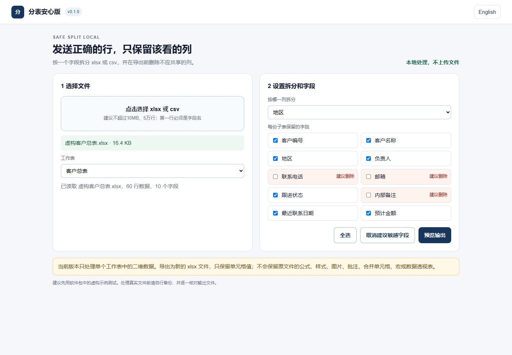
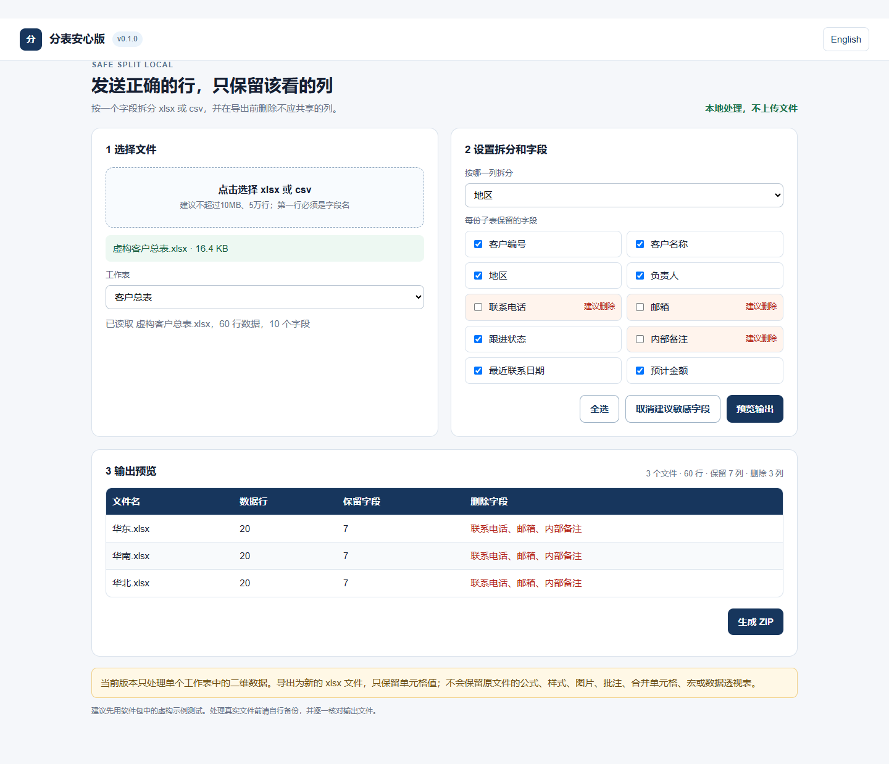

# 分表安心版（SafeSplit Local）

> 一款在本地浏览器中运行的轻量 Excel 分表工具：按字段拆分表格、删除不应外发的字段，并在导出前预览结果。

## 爱发电主页与售价

- **爱发电个人主页：<https://ifdian.net/a/mmh23_>**
- **分表安心版统一售价：人民币 10 元**

本仓库只用于公开展示产品信息和真实运行截图，不提供付费软件包或完整源码。实际交付以爱发电商品页面说明为准。

## 软件能做什么

- 读取 `.xlsx` 和 `.csv` 表格。
- 选择一个工作表，并按地区、部门、负责人等一个字段拆分数据。
- 自主勾选需要保留的字段，在导出前排除电话、邮箱、内部备注等不应外发的列。
- 预览每个子表的文件名、分组值、行数以及已排除字段。
- 将多个 `.xlsx` 子表打包为一个 ZIP 文件下载。
- 支持中文、英文界面切换。
- 在本地浏览器中离线处理，表格不会上传到服务器。

## 真实运行截图

### 加载虚构示例表格并选择拆分字段

### 导出前预览分组及已排除字段

截图使用的是虚构示例数据，不包含客户或个人的真实敏感信息。

## 基本使用方法

1. 解压购买后获得的软件包。
2. 使用 Microsoft Edge 或 Google Chrome 打开 `分表安心版.html`。
3. 选择本地 `.xlsx` 或 `.csv` 文件。
4. 选择需要处理的工作表和拆分字段。
5. 勾选需要保留的字段，并核对敏感字段提示。
6. 查看输出预览，确认文件名、行数和排除字段。
7. 导出 ZIP 压缩包并抽查其中的子表。

## 运行要求

- Windows 10 或 Windows 11。
- 推荐使用最新版 Microsoft Edge 或 Google Chrome。
- 无需安装，无需注册软件账号；解压后在本地浏览器中运行。
- 输入文件格式为 `.xlsx` 或 `.csv`。

## 已知限制

- 默认把所选工作表的第一行作为表头。
- 每次处理一个工作表，并按一个字段拆分。
- 当前版本以单元格值为主，不保留原表公式、样式、图片、批注、合并单元格、宏和数据透视表。
- 建议单个文件不超过 10 MB、数据量不超过约 5 万行；实际速度取决于电脑配置和字段数量。
- 分组字段为空的记录会归入“未分组”。
- 不支持旧版 `.xls` 文件，请先另存为 `.xlsx` 或 `.csv`。
- 工具不能替代组织内部的数据安全审批，导出前仍需人工核对结果。

## 隐私与展示说明

- 表格只在用户电脑本地处理，不上传服务器。
- 本仓库不包含软件安装包、付费压缩包、完整源码、开发密钥、账号密码或私人数据。
- 本页面不包含虚构的用户评价、销量或开发经历。

## 项目状态

当前展示版本：v0.1.0。核心拆分、字段筛选、预览和 ZIP 导出流程已使用虚构示例表格进行实际验证。

